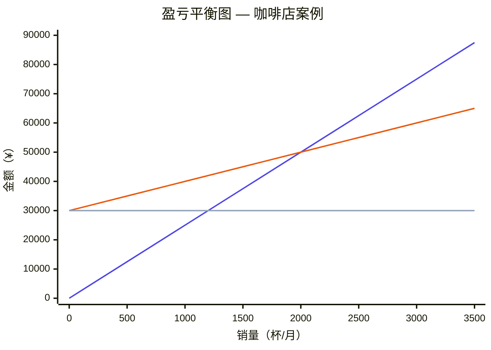

# 盈亏平衡点（Break-Even Point, BEP）

> **所属领域**：财务与经营管理

> **作者**：黄一恒 2025203056
---

## 一、定义

**盈亏平衡点**是指企业的总收入恰好等于总成本（固定成本 + 变动成本）时所对应的业务量（销量、产量或销售额）。在该点上，企业的**经营利润（即收入减去固定成本与变动成本）为零**，既不盈利也不亏损。需注意，此处"利润为零"的含义取决于成本覆盖范围——若固定成本中已包含利息和所得税，则对应净利润为零；若仅含经营性成本，则对应的是息税前利润（EBIT）为零。

在最简单的**单产品模型**中，盈亏平衡点的计算公式为：

$$
BEP_{数量} = \frac{固定成本}{单位售价 - 单位变动成本} = \frac{固定成本}{单位贡献毛利}
$$

其中：

| 符号 | 含义 |
|------|------|
| 固定成本（FC） | 不随产销量变化的成本，如租金、折旧、管理人员薪酬等 |
| 单位售价（P） | 每一单位产品的销售价格 |
| 单位变动成本（VC） | 每生产/销售一单位产品而增加的成本，如原材料、计件工资等 |
| 单位贡献毛利（CM） | 单位售价减去单位变动成本，即 $P - VC$ |

> [!NOTE]
> 贡献毛利（Contribution Margin）指的是每销售一个单位产品后，用于"贡献"覆盖固定成本并最终形成利润的那部分金额。

> [!IMPORTANT]
> **基本模型的前提条件**（违反任一条件均可能导致分析结论失真）：
> 1. **单位售价大于单位变动成本**（$P > VC$）——否则贡献毛利为负，卖得越多亏得越多，不存在盈亏平衡点。
> 2. **产销一致**——产量等于销量，不存在期初期末存货变动，避免因存货吸收固定成本而扭曲利润。
> 3. **相关范围（Relevant Range）**——分析仅在一定的产销量区间内有效，在此区间内单位售价和单位变动成本保持不变，固定成本总额不发生阶梯式跳变。

---

## 二、背景与上下文

### 2.1 为什么重要？

盈亏平衡分析是企业经营决策中**最基础、最广泛使用**的财务分析工具之一。它帮助管理者回答一个核心问题：

> **"我至少要卖多少，才能不赔钱？"**

### 2.2 应用场景

| 场景 | 具体用途 |
|------|----------|
| **创业与商业计划** | 评估新项目是否具有商业可行性，投资回收需要多大的销量 |
| **定价决策** | 判断不同定价策略下需要达到的最低销量 |
| **成本控制** | 分析降低固定成本或变动成本对盈利门槛的影响 |
| **产能规划** | 评估扩大产能后新的盈亏平衡点，辅助投资决策 |
| **风险评估** | 衡量当前销量距离盈亏平衡点的安全边际（Margin of Safety） |

### 2.3 历史沿革

盈亏平衡分析源于20世纪初的管理会计实践，与**成本-产量-利润分析（CVP分析，Cost-Volume-Profit Analysis）** 密切相关。CVP分析是盈亏平衡分析的上位框架，研究的是成本结构、销售量与利润之间的整体关系，而盈亏平衡点是CVP分析中利润为零的那个特殊点。

---

## 三、举例说明

### 示例：一家咖啡店的盈亏平衡分析

假设小王开了一家咖啡店，经营数据如下：

| 项目 | 金额 |
|------|------|
| 每月固定成本（房租 + 人工 + 设备折旧等） | ¥30,000 |
| 每杯咖啡售价 | ¥25 |
| 每杯咖啡的变动成本（咖啡豆、杯子、牛奶等） | ¥10 |

**计算过程：**

$$
单位贡献毛利 = 25 - 10 = 15 \text{（元/杯）}
$$

$$
BEP = \frac{30{,}000}{15} = 2{,}000 \text{（杯/月）}
$$

**解读：**

- 小王每月至少要卖出 **2,000杯** 咖啡才能不亏损。
- 如果每月营业25天，则平均每天需要卖出 **80杯**。
- **在相关范围内**（即单价和单位变动成本保持不变的产销量区间），每多卖出1杯，贡献 **¥15的经营利润**。
- 如果某月卖出2,500杯，则本例简化经营利润为 $(2{,}500 - 2{,}000) \times 15 = ¥7{,}500$（此处未扣除利息与所得税，实际净利润需进一步调整）。

### 盈亏平衡图

> [!NOTE]
> **图形解读**：总收入线（🔵靛蓝）从原点出发，斜率 = 单价 ¥25；总成本线（🟠橙色）从 ¥30,000 出发，斜率 = 单位变动成本 ¥10；固定成本线（⚪灰色）为水平线 ¥30,000。总收入线与总成本线在 **2,000 杯（¥50,000）** 处相交，即盈亏平衡点。交点左侧为亏损区，右侧为盈利区。

下表列出图中关键数据点，便于精确对照：

| 销量（杯/月） | 总收入（¥） | 总成本（¥） | 利润（¥） | 状态 |
|:-:|:-:|:-:|:-:|:-:|
| 0 | 0 | 30,000 | −30,000 | 🔴 亏损 |
| 500 | 12,500 | 35,000 | −22,500 | 🔴 亏损 |
| 1,000 | 25,000 | 40,000 | −15,000 | 🔴 亏损 |
| 1,500 | 37,500 | 45,000 | −7,500 | 🔴 亏损 |
| **2,000** | **50,000** | **50,000** | **0** | **⚪ 盈亏平衡** |
| 2,500 | 62,500 | 55,000 | +7,500 | 🟢 盈利 |
| 3,000 | 75,000 | 60,000 | +15,000 | 🟢 盈利 |
| 3,500 | 87,500 | 65,000 | +22,500 | 🟢 盈利 |

---

## 四、对比分析

### 4.1 盈亏平衡点 vs. 安全边际（Margin of Safety）

| 概念 | 含义 | 关注点 |
|------|------|--------|
| **盈亏平衡点** | 利润为零时的业务量 | "底线在哪里？" |
| **安全边际** | 实际（或预期）销量超出盈亏平衡点的部分 | "我离底线还有多远？" |

$$
安全边际率 = \frac{实际销量 - BEP销量}{实际销量} \times 100\%
$$

以上例为例，若小王实际月销2,500杯：安全边际率 = $(2{,}500 - 2{,}000) / 2{,}500 = 20\%$，意味着销量下降不超过20%仍不会亏损。

### 4.2 盈亏平衡点 vs. 投资回收期（Payback Period）

| 维度 | 盈亏平衡点 | 投资回收期 |
|------|-----------|-----------|
| **衡量对象** | 经营层面：收入覆盖当期成本 | 投资层面：累计回报覆盖初始投入 |
| **时间维度** | 通常针对某一期间（月/年） | 跨多个期间的累计概念 |
| **核心问题** | "卖多少才不亏？" | "多久能回本？" |

### 4.3 盈亏平衡点 vs. 目标利润点

盈亏平衡点是目标利润为零时的特殊情况。若需要实现目标利润 $\pi$，则：

$$
目标销量 = \frac{固定成本 + 目标利润}{单位贡献毛利}
$$

---

## 五、深入扩展

### 5.1 多产品盈亏平衡分析

现实中企业往往经营多种产品，此时需要使用**加权平均贡献毛利**：

$$
BEP_{总销售额} = \frac{固定成本}{加权平均贡献毛利率}
$$

其中加权平均贡献毛利率按各产品的销售额占比进行加权。

### 5.2 非线性盈亏平衡

基本模型假设单位售价和单位变动成本恒定，但实际中：

- **售价可能随销量增加而降低**（量大打折）
- **变动成本可能存在规模效应**（批量采购降低单位成本）
- **固定成本可能呈阶梯式变化**（产能扩张时跳增）

此时收入线和成本线不再是直线，可能出现**多个盈亏平衡点**。

### 5.3 现金盈亏平衡点

传统盈亏平衡点基于**会计利润**。但折旧、摊销等非现金成本不需要实际支出现金，因此还可以计算**现金盈亏平衡点**：

$$
BEP_{现金} = \frac{固定成本 - 非现金固定成本（如折旧、摊销）}{单位贡献毛利}
$$

> [!WARNING]
> **该公式成立的附加假设**：
> 1. **同期间收付假设**——销售收入在当期全部收现，变动成本在当期全部付现（即不存在应收/应付账款的账期差异）。
> 2. **无营运资本变动**——期间内存货、预付款等营运资本净额保持不变。
> 3. **不含投资与筹资现金流**——公式仅涉及经营性现金流出入，未考虑资本性支出、贷款本金偿还、利息支付等。
>
> 因此，达到现金盈亏平衡销量**并不等于企业现金流不会断裂**。实际偿债能力评估需编制**现金余额预测表**，综合考虑应收账款回款周期、应付账款支付节奏、债务本息偿还计划及资本性支出安排。

现金盈亏平衡点低于会计盈亏平衡点，反映的是**仅就经营性现金流而言**，企业维持当期经营性现金收支平衡的最低业务量。

**现金保本 vs. 全面现金预测对比**：

| 维度 | 现金盈亏平衡点 | 现金余额预测 |
|------|:---:|:---:|
| 覆盖范围 | 仅经营性现金流 | 经营 + 投资 + 筹资全部现金流 |
| 账期处理 | 假设当期收付 | 按实际账期逐月/逐周排列 |
| 债务偿还 | 未纳入 | 纳入本金与利息 |
| 适用场景 | 快速估算经营性保本门槛 | 评估企业真实偿债能力与资金缺口 |

### 5.4 经营杠杆效应

盈亏平衡点与**经营杠杆（Operating Leverage）** 紧密相关：

- **固定成本占比高** → 盈亏平衡点高 → 经营杠杆大 → 销量波动对利润的放大效应强
- **变动成本占比高** → 盈亏平衡点低 → 经营杠杆小 → 利润对销量变动的敏感度低

> [!IMPORTANT]
> 高经营杠杆是一把"双刃剑"：在景气时利润增长快，在不景气时亏损也来得快。理解盈亏平衡点有助于管理者评估并管理这一风险。

### 5.5 局限性

| 局限 | 说明 |
|------|------|
| **线性假设** | 假设售价和单位变动成本不变，实际可能随规模变化 |
| **成本分类困难** | 混合成本（如水电费）难以严格分为固定和变动 |
| **单期静态分析** | 未考虑时间价值、库存变化等动态因素 |
| **忽略不确定性** | 未体现市场需求波动、原材料价格波动等风险 |

---

## 六、简明总结

> [!TIP]
> **核心要点速览**

1. **盈亏平衡点**是总收入 = 总成本、经营利润为零时的业务量，是企业经营的"生死线"。前提条件包括 $P > VC$、产销一致及相关范围假设。
2. **基本公式**：$BEP = 固定成本 \div 单位贡献毛利$，简洁实用，但结论仅在相关范围内有效。
3. **实际意义**：帮助管理者做好定价、成本控制、产能规划和风险评估。
4. **延伸概念**：安全边际衡量距离盈亏平衡点的缓冲空间；经营杠杆反映利润对销量变动的敏感度。
5. **使用注意**：基本模型依赖线性假设，复杂场景需结合非线性分析、敏感性分析等工具。

---

## 参考文献

> 以下文献著录格式遵循 **GB/T 7714—2015**《信息与文献 参考文献著录规则》。

[1] 孙茂竹, 文光伟, 杨万贵. 管理会计学[M]. 7版. 北京: 中国人民大学出版社, 2021: 78-112.

[2] 中国注册会计师协会. 财务成本管理[M]. 北京: 中国财政经济出版社, 2024: 203-240.

[3] 荆新, 王化成, 刘俊彦. 财务管理学[M]. 9版. 北京: 中国人民大学出版社, 2021: 156-178.

[4] 于富生, 黎来芳, 张敏. 成本会计学[M]. 8版. 北京: 中国人民大学出版社, 2020: 265-290.

[5] GARRISON R H, NOREEN E W, BREWER P C. 管理会计学[M]. 韦小泉, 刘珺, 译. 16版. 北京: 机械工业出版社, 2020: 181-224.

[6] HORNGREN C T, DATAR S M, RAJAN M V. 成本会计: 管理的强调[M]. 王立彦, 译. 16版. 北京: 中国人民大学出版社, 2019: 63-98.

[7] HILTON R W, PLATT D E. 管理会计: 创造商业价值[M]. 杨雄胜, 译. 12版. 北京: 机械工业出版社, 2021: 255-289.

[8] 中华人民共和国国家质量监督检验检疫总局, 中国国家标准化管理委员会. 信息与文献 参考文献著录规则: GB/T 7714—2015[S]. 北京: 中国标准出版社, 2015.
