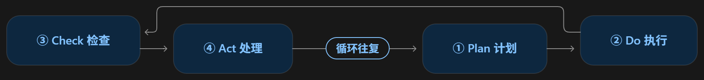
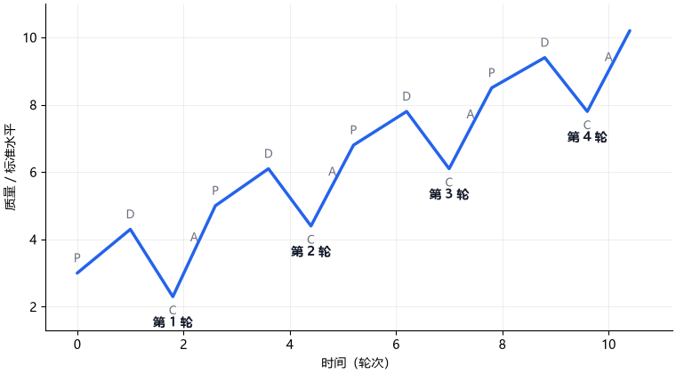
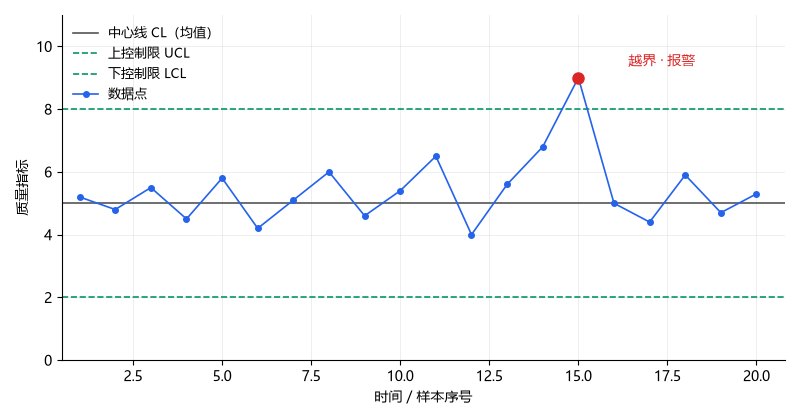

# 持续改进（PDCA）

> 姓名：张健福　学号：2025201435

## 一、定义

**PDCA 循环**（又称戴明环、休哈特循环）是一种迭代式的四步管理方法，通过计划（Plan）— 执行（Do）— 检查（Check）— 处置（Act）的不断循环，实现流程与产品的控制和持续改进。

## 二、背景和上下文

### 思想起源与定名

它的思想源头可以追溯到 17 世纪英国哲学家弗朗西斯·培根（Francis Bacon）在《新工具》（*Novum Organum*, 1620）中提出的方法论，即先提出假设、再通过实验验证、最后评价结果[1]。1939 年，美国贝尔电话实验室的统计学家沃尔特·安德鲁·休哈特（Walter Andrew Shewhart）在《从质量控制角度看统计方法》（*Statistical Method from the Viewpoint of Quality Control*）中，将其具体化为“规格—生产—检验”的三步循环，成为 PDCA 的直接前身[2]。

1950 年，美国统计学家威廉·爱德华兹·戴明（William Edwards Deming）应日本科学技术联盟（JUSE）之邀赴日讲学，把这套循环的思想传入日本，日本听众将它整理为今天通行的“计划—执行—检查—处理”四步，PDCA 之名由此定型，并随着日本质量管理走向世界，因此它又常被称为戴明环[3]。

不过其中有一个非常有趣的细节：戴明本人并不认可“检查”一词，他认为“检查”是被动的、事后把关，而改进的本质是主动学习，于是他在 1986 年出版的《走出危机》（*Out of the Crisis*）中把它改为“研究”（Study），称这套方法为 PDSA 循环，并命名为“学习和改进的休哈特循环”，此后又在 1993 年的《新经济学》中进一步阐明这一立场[3][4]。事实上，戴明本人从未使用过 PDCA 这个说法[5]，只是在日本传播的过程中出现了细微的偏差。

### 最初的使用与重要性

主要在两个场景。
一是二战期间美国的战时工业生产，戴明向美国军工企业的工程师讲授统计质量控制，帮助提高战时工业产品的质量。
二是战后日本，1950 年戴明应日本科学技术联盟（JUSE）之邀，向日本制造业的管理层和工程技术人员系统讲授这套方法，日本企业把它落实到生产线上，逐步发展出品管圈（QC Circle，由石川馨倡导）、全面质量管理（Total Quality Management, TQM）、Kaizen（持续改善）以及丰田生产方式（Toyota Production System）等一整套实践[3][6][12]。丰田等日本企业正是靠着“把质量做进过程里、再一轮一轮改进”的循环，实现了产品从“廉价劣质”到“高质量”的转型。

PDCA 把质量管理从“事后检验、挑出废品”，变成了“过程控制、预防缺陷”。过去企业靠质检员在流水线末端把关，次品已经造出来了才被拦住；而 PDCA 的逻辑是提前控制过程、找出波动的根源，从源头上让产品稳定。正是这个转变，后来支撑起了六西格玛、精益生产等现代质量方法，也让日本制造在几十年里树立起全球性的质量声誉。

### 近年的拓展与更新

一是医疗与公共服务。美国卫生保健改进研究所（Institute for Healthcare Improvement, IHI）把 PDCA 的戴明版本——以“研究（Study）”替代“检查（Check）”的 PDSA——作为“改进模型”的核心，用于临床质量与患者安全的快速迭代试验，使这一循环成为医疗质量改进领域的标准方法[7]。

二是管理体系标准。国际标准化组织（International Organization for Standardization, ISO）在 ISO 9001:2015《质量管理体系 要求》中采用高阶结构，整部标准的条款按 PDCA 逻辑组织；此后环境（ISO 14001）、职业健康安全（ISO 45001）、能源（ISO 50001）、信息安全（ISO 27001）、业务连续性（ISO 22301）等管理体系标准都沿用这一框架，PDCA 从一项工具上升为现代管理体系的通用骨架[8]。

三是软件与创业。精益创业提出的“构建—测量—学习”循环与 PDCA 同源，被广泛用于互联网产品和初创企业的快速迭代[9]。

四是可持续性与 ESG。近年研究把 Kaizen 与 PDCA 结合，用于度量企业的社会可持续性与经济可持续性绩效，表明 PDCA 已从质量领域扩展到可持续管理领域[10]。

五是数字化与人工智能。随着工业 4.0 的推进，出现了把 PDCA 与机器学习、大数据结合的新方法，例如 KaizenAI 将持续改进的循环结构作为人工智能预测引擎的骨架，在装瓶等行业落地，使 PDCA 从“人驱动的改进循环”升级为“人机协同的智能改进循环”[11]。

## 三、举例说明

以一家电子厂改进回流焊过程为例，可以直观地看到 PDCA 的四步如何运转。这个例子的重点不是加强出厂检验，而是改进生产过程本身。

- **Plan（计划）**：目标是让焊接不良率从 3% 降到 1%。分析发现，不良的根源不在检验环节，而在回流焊的温度曲线设置不合理，于是制定“重新设定温度曲线”的改进方案。
- **Do（执行）**：先在一条产线小范围试行新温度曲线一周，如实记录过程参数与焊接结果。
- **Check（检查）**：对比试行前后的数据，发现不良率明显下降，但波动仍然偏大；进一步分析确认，温度传感器老化是波动的主要来源（属于可查明的特殊原因）。
- **Act（处理）**：更换传感器，把新温度曲线固化为作业标准推广到全部产线，不良率稳定在 1% 左右，再进入下一轮 PDCA。

这个例子中，改进的对象是过程参数而非检验拦截；Do 阶段先暴露问题、Act 阶段再修正，只是众多可能情形中的一种：试点试验并不保证一次成功，关键在于如实记录并从中学习。

## 四、对比分析

### 相似概念

**PDSA 循环**。PDCA 最直接的近亲是 PDSA 循环（计划—执行—研究—处理），两者只有第三个词不同：一个用“检查”（Check），一个用“研究”（Study）。这处差异正是最大的误解来源——戴明本人从不用 PDCA，他坚持用 Study，认为“检查”是被动的事后核对，而改进的本质是主动研究、理解差异[3][4]。严格说，学界更严谨的叫法是 PDSA。

**Kaizen（持续改善）**。Kaizen 常和 PDCA 并列，甚至被当作同义词。其实两者是“哲学与工具”的关系：Kaizen 是一种“人人参与、每天进步一点点”的管理哲学，而 PDCA 是落实这套哲学最常用的工具——每一次小改善，往往就是走一遍 PDCA[6]。

**SDCA 循环**。SDCA（标准化—执行—检查—处理）是 PDCA 的搭档：PDCA 负责“改善”，把现状推向更高水平；SDCA 负责“维持”，把改进后的好做法固化成标准并守住它，二者交替进行[6]。这能纠正一个常见误解——以为 PDCA 只讲“变”，其实成熟的管理是“变”与“守”交替。

### 相反概念

**线性的一次成型**。与 PDCA 相反的是“瀑布式”的线性做法：先完整规划、再一次性执行、最后验收，做完即结束。PDCA 的意义正在于反对这种一次成型的假设——现实复杂多变，所以要靠小步循环、持续修正来逼近目标。这也是它在动态环境中仍然有效的原因。

**事后检验的旧范式**。在质量管理内部，PDCA 取代的老范式是“末端检验”：靠质检员在产品完成后挑出次品。PDCA 代表的是“过程预防”：在生产过程中就控制波动、消除缺陷根源[2]。这不是技术差异，而是管理理念的根本转向。

## 五、深入扩展：内部逻辑与运作机制

PDCA 的机制本质是一个带反馈的闭环：每一轮的产出是下一轮更聪明、更准确的计划，让改进建立在上一轮的学习之上，而不是机械地重复原样。下面先用一张图把四阶段和回路画出来，再逐个阶段讲透它内部是怎么运转的。

### 循环示意

四个节点按“计划（Plan）→ 执行（Do）→ 检查（Check）→ 处理（Act）”的顺序依次排列，处理（Act）再通过回环箭头回到计划（Plan），表示一轮的结束正是下一轮的起点，如此循环往复、持续改进。

### 螺旋上升示意（仅为假设轨迹）

下图仅用于直观展示“暴露问题—修正—再前进”的循环思路，并非每轮必然发生的过程路径：PDCA 的各阶段并不规定指标的确定走势，Do 阶段的试验也可能失败、未必带来改善。横轴是时间（轮次），纵轴是质量/标准水平；图中“先升—后降—再升”的形态是一种简化假设，不代表真实情况一定如此。

### Plan（计划）

计划阶段做三件事：明确目标、识别现状与目标的差距、设计缩小差距的方案。它内部有一个隐含的硬要求——目标必须是可检验的。因为后面 Check 要拿结果和它对比，如果目标是“提高质量”这种模糊说法，Check 就无从下手。所以 Plan 的真正产物不是一个愿望，而是一句可证伪的假设：“如果我们做 X，预期 Y 指标会变成 Z”。

用公式表达，Plan 要识别的是差距：

$$d = \text{目标值} - \text{实际值}$$

这句话写不出来，后面的循环就是空转。

### Do（执行）

Do 阶段有两个容易被忽视的要点。第一，它通常是小规模的“试点”，而不是全面铺开——先在一小块上验证，成本低、容易归因。第二，它的真正产出不是“把事办了”，而是“记录了一组真实数据”。需要特别强调的是，试点本质上是一种试验，可能成功、也可能失败，失败同样是有效的信息；如果 Do 阶段没有忠实记录过程和结果（无论成败），下一阶段的 Check 就失去了对象。很多人把 PDCA 做失败，问题恰恰出在这里：执行的时候图快、不留数据，结果循环在 Check 这里断了。

### Check（检查）

Check 不是“打个勾、看看达标没有”，而是三件事的叠加：把实际结果和 Plan 阶段的预期做对比、找出两者之间的差异、追查差异背后的原因。这里还要做一个关键区分——差异是偶然的随机波动（普通原因），还是系统性的、可查明的问题（特殊原因）。这正是休哈特和戴明反复强调的统计思维[2][3]。

用统计语言说，Check 的核心是判断偏差属于哪一种原因。休哈特控制图是实现这一判断的常用工具，但它给出的是“值得进一步调查的信号”，而不是无条件判定：

- 控制图有多种图型，取决于数据类型和样本单位（子组大小 n）：计量数据常用均值—极差图（$\bar{X}$-R 图）或单值—移动极差图（I-MR 图），计数数据常用不合格品率图（p 图）或缺陷数图（c 图）等。
- 以均值图为例，控制限按样本均值的抽样分布设置，取 $\bar{X} \pm 3\,\sigma/\sqrt{n}$，其中 $\sigma/\sqrt{n}$ 是样本均值的标准误（实践中常用极差或样本标准差来估计）。
- 单点越出控制限，只提示“可能存在特殊原因、值得调查”，并不自动断言就是特殊原因；同样，落在限内也不等于只有普通原因，还需结合异常模式规则（如连续 8 个点位于中心线同一侧、连续上升或下降等）综合判断。

下图以最常用的均值控制图为例，直观展示中心线、控制限与越界报警点：

戴明晚年坚持把 Check 改成 Study，深层原因就在这里：他要的是一轮“读懂结果、更新认知”的学习，而不是一次被动的核对。换句话说，Check 的产出不是“及格/不及格”，而是“我们知道了什么新东西”。

### Act（处理）

Act 只有两种正当动作。一种是把 Check 确认有效的做法固化下来——写成标准、推广到更大范围，这一步通常会交给前面提到过的 SDCA 去“守”。另一种是发现无效或不够好，就修正原来的假设，带着新认识回到 Plan，开启下一轮。

值得强调的是，Act 的“处理”不是把问题甩给执行层去改，而是改“方案本身”和“背后的假设”。这一环做扎实了，验证有效的做法被固化下来，下一轮就能站在更高的起点上继续改进；这一环敷衍了，PDCA 就退化成“同样的错误换着花样重复”。

## 六、简明总结

1. PDCA 是一个迭代式的四步闭环：计划（Plan）→ 执行（Do）→ 检查（Check）→ 处理（Act），周而复始、持续改进。
2. 它的思想源于培根的科学方法和休哈特的统计质量控制，由戴明传入日本并走向世界，最初用于制造业，现已扩展到医疗、管理体系、创业、可持续性与人工智能等领域。
3. 重点在 Check：核心不是“检验把关”，而是“对比、找差、究因”的学习过程——这正是戴明坚持用 Study 的原因。
4. 关键在 Act：有效就固化（交给 SDCA 守住），无效就修正假设再循环，如此“变与守交替”，改进才得以持续推进而非原地打转。

## 参考文献
>[1] Bacon F. Novum Organum[M]. London: John Bill, 1620.
>
>[2] Shewhart W A. Statistical Method from the Viewpoint of Quality Control[M]. Washington: The Graduate School, U.S. Department of Agriculture, 1939.
>
>[3] Deming W E. Out of the Crisis[M]. Cambridge, MA: MIT Center for Advanced Engineering Study, 1986.
>
>[4] Deming W E. The New Economics for Industry, Government, Education[M]. Cambridge, MA: MIT Center for Advanced Engineering Study, 1993.
>
>[5] Moen R, Norman C. Circling back: clearing up myths about the Deming cycle and seeing how it keeps evolving[J]. Quality Progress, 2010, 43(11): 22-28.
>
>[6] Imai M. Kaizen: The Key to Japan's Competitive Success[M]. New York: McGraw-Hill, 1986.
>
>[7] Langley G J, Nolan K M, Nolan T W, et al. The Improvement Guide: A Practical Approach to Enhancing Organizational Performance[M]. San Francisco: Jossey-Bass, 1996.
>
>[8] ISO. ISO 9001:2015 Quality management systems — Requirements[S]. Geneva: International Organization for Standardization, 2015.
>
>[9] Ries E. The Lean Startup: How Today's Entrepreneurs Use Continuous Innovation to Create Radically Successful Businesses[M]. New York: Crown Business, 2011.
>
>[10] Alcaraz J L G, Limón Romero J, Duque Aguilar J I, et al. Integration of Kaizen-PDCA for economic and social sustainability in the manufacturing industry: a structural equation model[J]. Process Integration and Optimization for Sustainability, 2026. DOI: 10.1007/s41660-026-00709-w.
>
>[11] Soto-Chambilla A, Fernández-Del-Carpio A, Córdova-Silva H, et al. KaizenAI: methodology for the integration of machine learning in manufacturing processes based on Kaizen principles. Case study: bottling industry[J]. Journal of Industrial Engineering and Management, 2026, 19(2): 288-304. DOI: 10.3926/jiem.9195.
>
>[12] Ishikawa K. What is Total Quality Control? The Japanese Way[M]. Lu D J, trans. Englewood Cliffs, NJ: Prentice-Hall, 1985.
